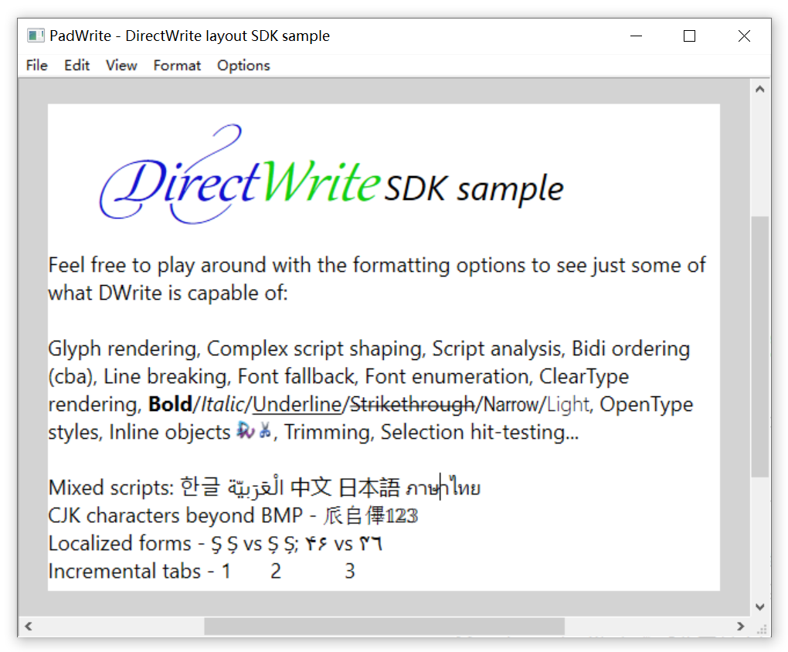

# PadWriteBufFix



This repository contains a fixed version of the Microsoft DirectWrite **PadWrite** sample:

- Original sample: <https://github.com/microsoft/Windows-classic-samples/tree/main/Samples/Win7Samples/multimedia/DirectWrite/PadWrite>

The original sample could not be built or run out of the box in Visual Studio 2026 with the Windows 10 SDK and C++14. This version fixes those compatibility issues and adds a MinGW-w64 build script.

## What was done

### Original compatibility fixes

- Updated the project so it can be built with modern Visual Studio toolsets (including Visual Studio 2026 / Windows 10 SDK / C++14).

### MinGW-w64 build support

- Added `build_padwrite.bat`, a MinGW-w64 build script modeled after the style of `build_litedocx.bat`.
- The script compiles resources with `windres`, compiles the C++ sources with `g++`, and links `PadWrite.exe`.

### Code changes for MinGW/GCC compatibility

- **`RenderTarget.h`**: Replaced non-standard pure virtual declarations using `= NULL` with standard C++ `= 0`.
- **`Common.h`**: Added MinGW-specific `__mingw_uuidof<...>` specializations for `DECLSPEC_UUID` classes (`DrawingEffect`, `InlineImage`, `RenderTarget`, `TextEditor`), because MinGW does not resolve `__uuidof` from `DECLSPEC_UUID` metadata the same way MSVC does.
- **`Common.h`**: Guarded the MSVC-only `#pragma warning(disable : 4100)` with `#ifdef _MSC_VER` to avoid GCC `-Wunknown-pragmas`.

### Warning cleanup

The MinGW build was cleaned up to compile without warnings. Fixes included:

- Commenting out unused parameters in callbacks/handlers.
- Fixing constructor member initialization order (`-Wreorder`).
- Adding explicit `[[fallthrough]]` annotations in intentional switch fallthroughs.
- Fixing narrowing/sign-compare issues with explicit casts and correct types.
- Initializing `SCROLLINFO` and `BITMAPINFO` structures fully.
- Removing non-null reference address checks (`&ref == NULL`) that triggered `-Wnonnull-compare`.
- Replacing a strict-aliasing type-pun cast with field-by-field copy for `DWRITE_MATRIX`.

## Building

### Visual Studio

Open `PadWrite.sln` or `PadWrite.vcxproj` in Visual Studio and build the desired configuration/platform as usual.

### MinGW-w64 (batch script)

The provided script is configured for the local MinGW-w64 installation at:

```bat
C:\Users\pr30565\Nim_code\mingw64\bin
```

Build from the repository root:

```bat
build_padwrite.bat [Release|Debug] [run]
```

- `Release` (default): optimized build, defines `NDEBUG`, strips symbols.
- `Debug`: debug build with `-g -O0` and `DEBUG`.
- `run`: launches the executable after a successful build.

Output:

- Executable: `Release_mingw\PadWrite.exe` or `Debug_mingw\PadWrite.exe`
- Object files/resources: `obj\`

## Notes

- The MinGW build uses `g++`, `windres`, and Windows/DirectWrite/Direct2D/WIC system libraries.
- The warning-cleanup pass focused on the MinGW/GCC build; behavior of the original sample was preserved.
